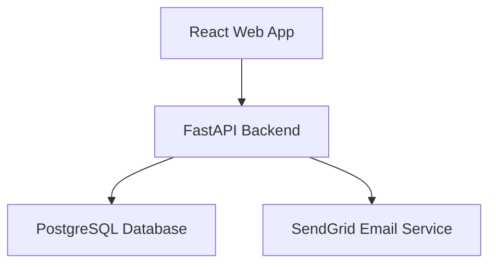
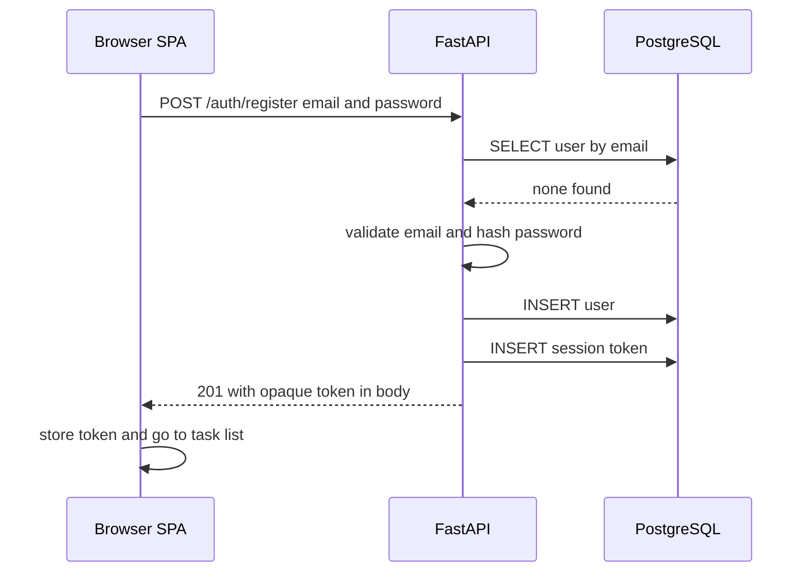
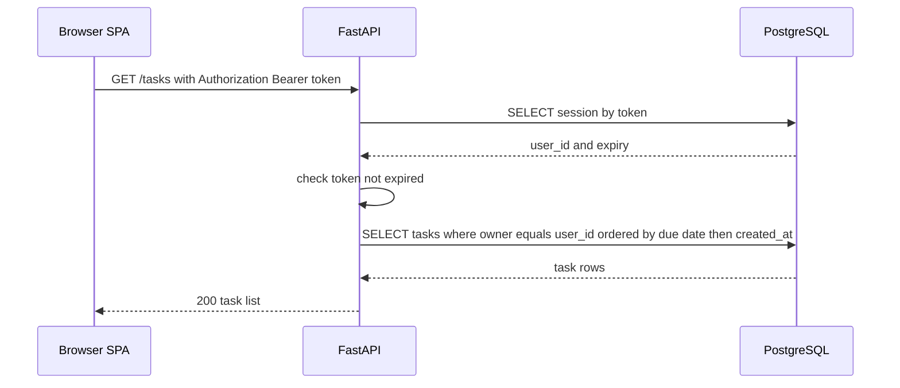
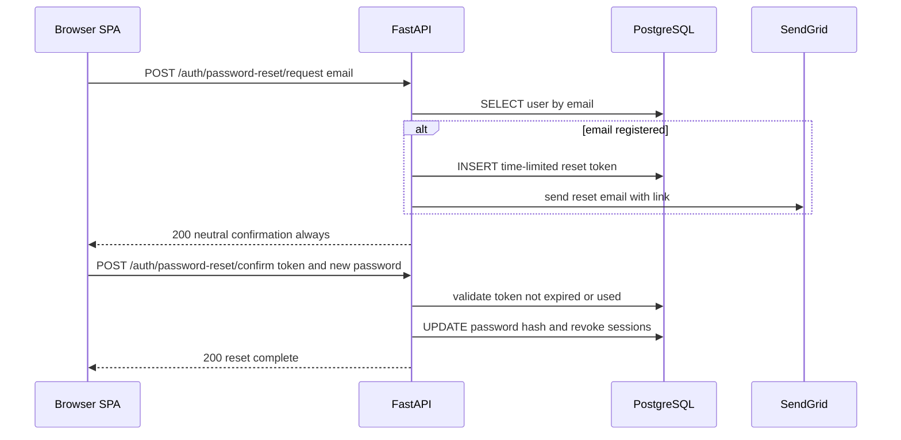
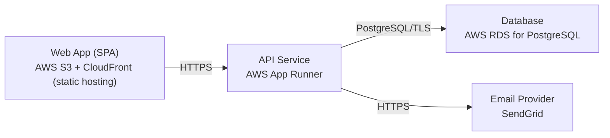

# Architecture

> Maintained by QuorQ AI SDLC. Text between `sdlc:auto` markers is regenerated; anything outside them is yours and is kept.

<!-- sdlc:auto:start narrative -->
## Overview

### ARCH-OVERVIEW · approved · source: architecture:summary

Approved (v1) architecture for a lightweight personal task-list web app: React 19 SPA, FastAPI 0.115 API, PostgreSQL 16, all on AWS.

A signed-in user manages only their own tasks (title, optional due date, done flag) with active/completed filtering and a due-date-then-creation-time sort. Authentication is email+password with server-side opaque-token sessions (stored and validated in PostgreSQL) sent as Authorization: Bearer; sign-out, password reset and account deletion revoke sessions server-side. Transactional emails for password reset go through SendGrid. Explicitly out of scope: teams, sharing, notifications.

### ARCH-COMP-SPA · approved · source: architecture:components:spa

React 19 single-page app serving every user-facing screen.

Responsive SPA for sign-up, sign-in, password reset, account deletion and the personal task list with add/edit/complete/delete, active/completed filtering and default sort. Stores the opaque session token and sends it as Authorization: Bearer on every API call. Built as a static SPA and deployed to AWS S3 + CloudFront, served from its own origin.

**Related:** ARCH-COMP-API, ARCH-TECH-FRONTEND

### ARCH-COMP-API · approved · source: architecture:components:api

FastAPI 0.115 backend exposing all auth and task endpoints.

Handles registration, sign-in, sign-out, password reset, account deletion, session validation, and per-user task CRUD with ownership enforcement, filtering and sorting. Deployed as FastAPI 0.115 on Python 3.12 (Uvicorn) on AWS App Runner.

**Related:** ARCH-COMP-DB, ARCH-COMP-EMAIL, ARCH-COMP-SPA, ARCH-TECH-BACKEND

### ARCH-COMP-DB · approved · source: architecture:components:db

PostgreSQL 16 database holding all persistent application state.

Stores users (with password hashes), opaque session tokens, password reset tokens, and tasks, with each task scoped to its owning user. Deployed as AWS RDS for PostgreSQL 16.

**Related:** ARCH-COMP-API, ARCH-DATA-MODEL, ARCH-TECH-DATABASE

### ARCH-COMP-EMAIL · approved · source: architecture:components:email

SendGrid transactional email service used solely for password resets.

Sends password-reset emails containing time-limited links. Integrated as a SaaS transactional email API (SendGrid). No other email types are sent -- no notifications, per project scope.

**Related:** ARCH-COMP-API, ARCH-FLOW-PASSWORD-RESET

### ARCH-FLOW-REGISTER-SIGNIN · approved · source: architecture:critical_paths:Register and sign in

Critical path for new-account creation and immediate sign-in, with no email verification step.

Step 1: A new visitor submits credentials to create an account. Step 2: The API hashes the password. Step 3: A session token is issued and returned directly in the response body. Step 4: The user lands on their task list immediately -- no email verification is performed.

**Related:** ARCH-COMP-API, ARCH-COMP-DB, ARCH-COMP-SPA, ARCH-API-AUTH

### ARCH-FLOW-TASK-CRUD · approved · source: architecture:critical_paths:Authenticated task CRUD with ownership

Critical path enforcing per-user ownership on every task read and write.

Every task request carries the Authorization: Bearer token. The API resolves the session to a user and scopes all reads and writes to that user; requests targeting another user's tasks are refused.

**Related:** ARCH-COMP-API, ARCH-COMP-DB, ARCH-API-TASKS

### ARCH-FLOW-PASSWORD-RESET · approved · source: architecture:critical_paths:Forgotten password reset

Critical path for self-service password reset that never reveals account existence.

Step 1: A user requests a reset; a neutral confirmation is always shown regardless of whether the email is registered. Step 2: If the email is registered, a time-limited reset token is emailed via SendGrid. Step 3: Using a valid, unexpired link sets a new password hash. Step 4: All existing sessions for that user are revoked.

**Related:** ARCH-COMP-API, ARCH-COMP-EMAIL, ARCH-COMP-DB, ARCH-API-AUTH

### ARCH-DATA-MODEL · approved · source: architecture:entities

Relational schema of four entities: users, sessions, password reset tokens and tasks.

- users: id, email, password_hash, created_at.
- sessions: id, user_id (references users), token_hash, expires_at, created_at.
- password_reset_tokens: id, user_id (references users), token_hash, expires_at, used_at, created_at.
- tasks: id, user_id (references users, enforces per-user ownership scoping), title, due_date, is_done, created_at, updated_at.

**Related:** ARCH-COMP-DB, ARCH-TECH-DATABASE

### ARCH-API-AUTH · approved · source: architecture:endpoints (auth & account)

Authentication and account-management REST endpoints.

1. POST /auth/register -- create an account with email and password, hash the password, issue a session and return its token; rejects duplicate email, invalid email format or empty password.
2. POST /auth/login -- sign in with email and password, returns an opaque session token in the body; invalid credentials return a generic message without revealing whether the email exists.
3. POST /auth/logout -- revokes the current session token server-side.
4. POST /auth/password-reset/request -- requests a password reset, always returns the same neutral confirmation; emails a time-limited reset link via SendGrid if the email is registered.
5. POST /auth/password-reset/confirm -- sets a new password using a valid, unexpired reset token, stores the new hash, and revokes all existing sessions.
6. DELETE /account -- permanently deletes the signed-in user's account and all their tasks, and ends all sessions.

**Related:** ARCH-COMP-API, ARCH-FLOW-REGISTER-SIGNIN, ARCH-FLOW-PASSWORD-RESET

### ARCH-API-TASKS · approved · source: architecture:endpoints (tasks)

Task CRUD REST endpoints scoped to the signed-in user's own tasks.

1. GET /tasks -- lists the signed-in user's tasks, optionally filtered by active or completed, sorted by due date ascending then creation time.
2. POST /tasks -- creates a task for the signed-in user with a required title and optional due date; created as active.
3. PATCH /tasks/{task_id} -- updates the title, due date (including clearing it) and/or done flag of a task the user owns; rejects an empty title; refuses tasks owned by others.
4. DELETE /tasks/{task_id} -- permanently deletes a task the user owns; refuses tasks owned by others.

**Related:** ARCH-COMP-API, ARCH-FLOW-TASK-CRUD

### ARCH-TECH-FRONTEND · approved · source: architecture:technology_decisions:Frontend

React 19 is the approved frontend technology; no alternatives were considered.

Renders the interactive per-user task list with in-place toggling of done/active, active/completed filtering and due-date sort without page reloads; stores the opaque session token to send as Authorization: Bearer; built as a static SPA served from its own origin.

**Related:** ARCH-COMP-SPA

### ARCH-TECH-BACKEND · approved · source: architecture:technology_decisions:Backend

FastAPI 0.115 is the approved backend technology; no alternatives were considered.

Provides the auth and task CRUD endpoints with little ceremony, validates request bodies via Pydantic, enforces per-user ownership, and issues and validates opaque session tokens stored in PostgreSQL.

**Related:** ARCH-COMP-API

### ARCH-TECH-DATABASE · approved · source: architecture:technology_decisions:Database

PostgreSQL 16 is the approved database technology; no alternatives were considered.

Stores users, hashed sessions, reset tokens and tasks as simple structured rows, with a unique email index, cascade delete for full account removal, and a composite index for the due-date-then-creation-time sort.

**Related:** ARCH-COMP-DB, ARCH-DATA-MODEL

### ARCH-TECH-CLOUD · approved · source: architecture:technology_decisions:Cloud

AWS is the approved cloud platform; no alternatives were considered.

Hosts the static SPA (S3/CloudFront), the API (App Runner) and the database (RDS PostgreSQL) in one place, scaling down to near-nothing when idle, with encryption in transit and at rest.

**Related:** ARCH-COMP-SPA, ARCH-COMP-API, ARCH-COMP-DB
<!-- sdlc:auto:end narrative -->

<!-- sdlc:auto:start building-blocks -->
## Building Block View

| ID | Name | Technology | Responsibility | Depends on |
|---|---|---|---|---|
| spa | React Web App | React 19 | Responsive SPA for sign-up, sign-in, password reset, account deletion and the personal task list with add/edit/complete/delete, active/completed filtering and default sort. Stores the opaque session token and sends it as Authorization: Bearer on every API call. | api |
| api | FastAPI Backend | FastAPI 0.115 | REST API handling registration, sign-in, sign-out, password reset, account deletion, session validation, and per-user task CRUD with ownership enforcement, filtering and sorting. | db, email |
| db | PostgreSQL Database | PostgreSQL 16 | Stores users (with password hashes), opaque session tokens, password reset tokens, and tasks, with each task scoped to its owning user. | — |
| email | SendGrid Email Service | SendGrid | Sends transactional password-reset emails with time-limited links. | — |

<!-- sdlc:auto:end building-blocks -->

<!-- sdlc:auto:start runtime -->
## Runtime View

### Register and sign in

A new visitor creates an account; the password is hashed, a session token is issued and returned in the response body, and the user lands on their task list without any email verification.

- **Components:** spa, api, db
- **Modules:** auth.router, auth.service, security.hashing, session.store
- **Key functions:** register(email, password), hash_password(password), create_session(user_id), sign_in(email, password)

### Authenticated task CRUD with ownership

Every task request carries the Bearer token; the API resolves the session to a user and scopes all reads and writes to that user, refusing access to other users' tasks.

- **Components:** spa, api, db
- **Modules:** tasks.router, tasks.service, auth.dependency, session.store
- **Key functions:** get_current_user(token), list_tasks(user_id, filter), create_task(user_id, title, due_date), update_task(user_id, task_id, changes), delete_task(user_id, task_id)

### Forgotten password reset

A user requests a reset; a neutral confirmation is always shown; if the email is registered a time-limited token is emailed via SendGrid; using a valid link sets a new hash and revokes all sessions.

- **Components:** spa, api, db, email
- **Modules:** auth.reset.router, auth.reset.service, security.hashing, email.sendgrid_client, session.store
- **Key functions:** request_reset(email), create_reset_token(user_id), send_reset_email(email, token), confirm_reset(token, new_password), revoke_all_sessions(user_id)

<!-- sdlc:auto:end runtime -->

<!-- sdlc:auto:start deployment-view -->
## Deployment View

| Name | Service | Runtime | Scaling | Environment |
|---|---|---|---|---|
| Web App (SPA) | AWS S3 + CloudFront (static hosting) | Static React 19 build | CDN edge, scales to zero origin cost when idle | dev |
| API Service | AWS App Runner | FastAPI 0.115 on Python 3.12 (Uvicorn) | Scales down to minimal/idle and up on demand | dev |
| Database | AWS RDS for PostgreSQL | PostgreSQL 16 | Single small instance, encrypted storage | dev |
| Email Provider | SendGrid | SaaS transactional email API | Managed by provider | dev |

| Source | Target | Protocol |
|---|---|---|
| Web App (SPA) | API Service | HTTPS |
| API Service | Database | PostgreSQL/TLS |
| API Service | Email Provider | HTTPS |

<!-- sdlc:auto:end deployment-view -->

<!-- sdlc:auto:start decisions -->
## Architecture Decisions

| Layer | Choice | ADR |
|---|---|---|
| Frontend | React 19 | [ADR-0001](adr/frontend.md) |
| Backend | FastAPI 0.115 | [ADR-0002](adr/backend.md) |
| Database | PostgreSQL 16 | [ADR-0003](adr/database.md) |
| Cloud | AWS | [ADR-0004](adr/cloud.md) |
<!-- sdlc:auto:end decisions -->

<!-- sdlc:auto:start links -->
## Related Documents

- [Data Model](data-model.md)
- [API Specification](api/openapi.yaml)
- [Architecture Decision Records](adr/README.md)
<!-- sdlc:auto:end links -->
