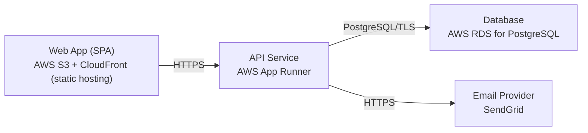

# Deployment Guide

> Maintained by QuorQ AI SDLC. Text between `sdlc:auto` markers is regenerated; anything outside them is yours and is kept.

<!-- sdlc:auto:start how-it-deploys -->
Pushes to `main` run `.github/workflows/deploy.yml`, which builds the API image (if there is a backend) and deploys the SPA to AWS Amplify. Commits touching only `docs/sdlc/**` don't deploy. Deployments can also be started from the platform's Deployment tab.
<!-- sdlc:auto:end how-it-deploys -->

<!-- sdlc:auto:start environments -->
| Name | Service | Runtime | Scaling | Environment |
|---|---|---|---|---|
| Web App (SPA) | AWS S3 + CloudFront (static hosting) | Static React 19 build | CDN edge, scales to zero origin cost when idle | dev |
| API Service | AWS App Runner | FastAPI 0.115 on Python 3.12 (Uvicorn) | Scales down to minimal/idle and up on demand | dev |
| Database | AWS RDS for PostgreSQL | PostgreSQL 16 | Single small instance, encrypted storage | dev |
| Email Provider | SendGrid | SaaS transactional email API | Managed by provider | dev |
<!-- sdlc:auto:end environments -->

<!-- sdlc:auto:start live -->
**Frontend URL:** https://pc769bd8e0925.d3j61xaup4zgrx.amplifyapp.com

**Backend URL:** https://34-216-35-180.sslip.io/apps/c769bd8e0925/

**Database:** PostgreSQL · app

**Version:** 2f08f3186d2a

**Commit:** `2f08f31`

**Finished:** 2026-11-18
<!-- sdlc:auto:end live -->

<!-- sdlc:auto:start topology -->

<!-- sdlc:auto:end topology -->
